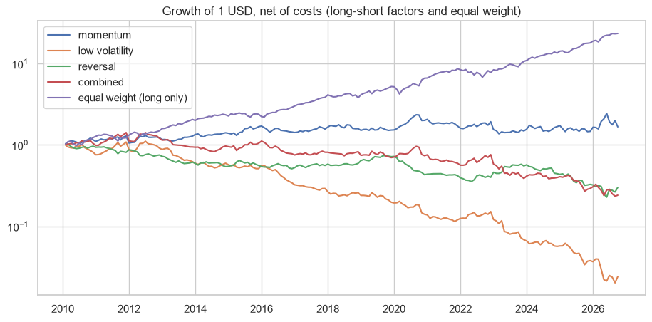

# factorbt: a small engine to backtest equity factor strategies

A Python package to backtest cross-sectional factor strategies (momentum, low volatility, reversal...) with monthly rebalancing and transaction costs, with tests on GitHub Actions (Python 3.11 to 3.13) and an example notebook.

## The package

| Module | What it does |
|---|---|
| `signals.py` | momentum 12-1, low volatility, short-term reversal, cross-sectional z-score |
| `portfolio.py` | weights of the top and bottom quantiles, long-only or long-short |
| `backtest.py` | weights decided at the end of month t earn the returns of month t+1; costs per unit of turnover |
| `metrics.py` | annual return, volatility, Sharpe, max drawdown, hit rate |

```python
from factorbt import momentum, quantile_weights, run_backtest, summary
w = quantile_weights(momentum(prices), quantiles=5, long_short=True)
bt = run_backtest(prices, w, cost_bps=10)
summary(bt["net"])
```

The tests use small synthetic data where the right answer is known: the signals do not look ahead, the weights sum 1 (long only) or 0 (long-short), a portfolio 100% in a stock that grows 2% per month earns exactly 2%, costs reduce returns, and the max drawdown is right.

## Example (`example.ipynb`)

Three factors on the 95 biggest US stocks with enough history, 2010-2026, 10 bp of costs:

| Strategy | Annual return | Sharpe | Max drawdown |
|---|---|---|---|
| Momentum (long-short) | 3.1% | 0.25 | -42% |
| Low volatility (long-short) | -20.0% | -0.83 | -98% |
| Reversal (long-short) | -6.9% | -0.33 | -78% |
| Equal weight (long only) | 20.7% | 1.33 | -21% |

- To check the engine, our momentum is compared with the official momentum factor of Kenneth French: correlation 0.80, beta 1.28 and zero alpha.
- The bad result of low volatility is survivorship bias: the biggest companies of today were often volatile ten years ago (Nvidia, Tesla), so shorting volatile stocks was shorting the future winners. The universe has to be point-in-time for a real test.
- Reversal turns over more than 300% per month, so costs destroy it: Sharpe -0.11 without costs, -1.20 with 50 bp.



## How to run

```
pip install -e . -r requirements.txt
pytest -q
jupyter notebook example.ipynb
```

---
Alejandro Lezcano Osorio | Rennes School of Business (MSc in Financial Data Intelligence) and Universidad EIA
